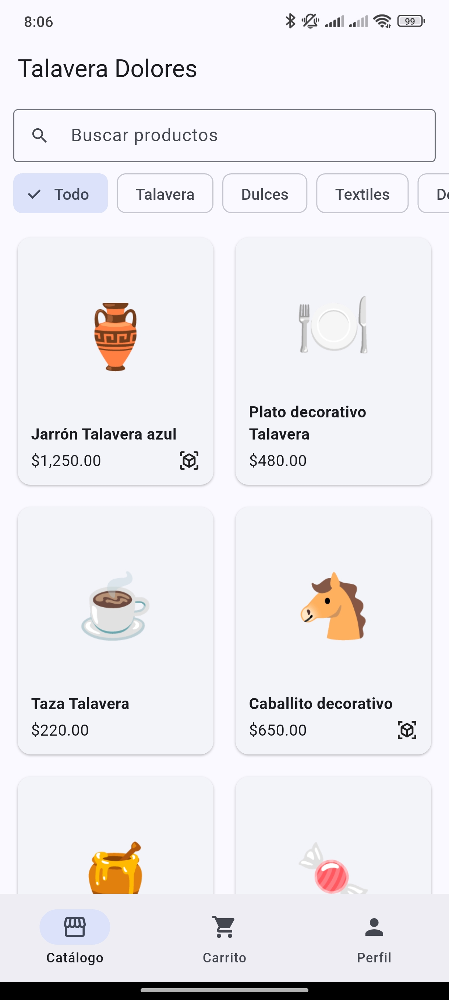
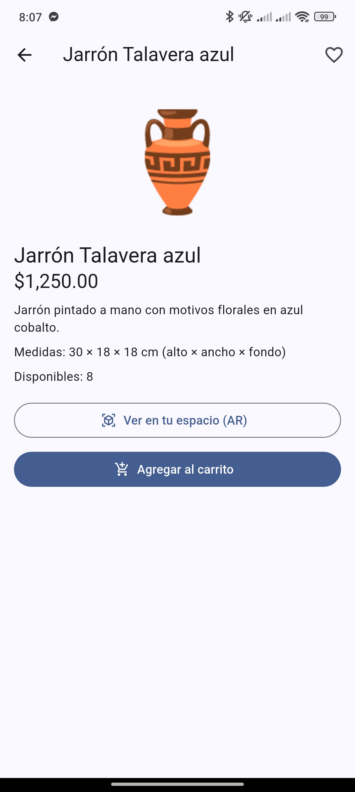
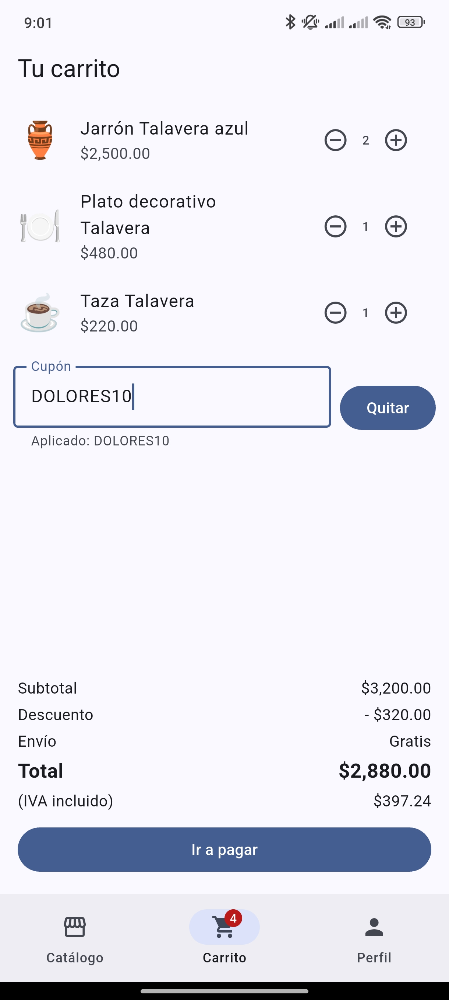
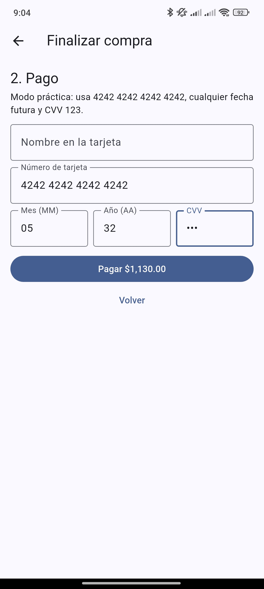
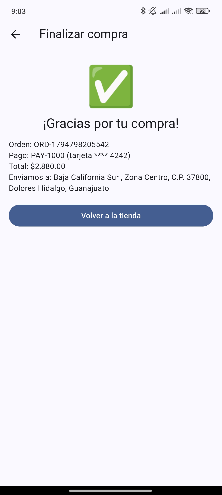
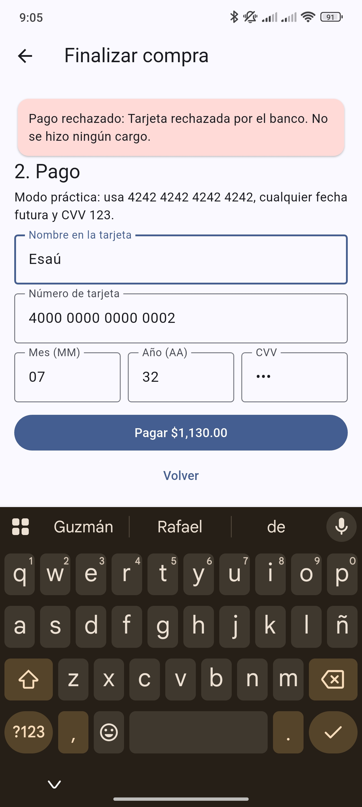
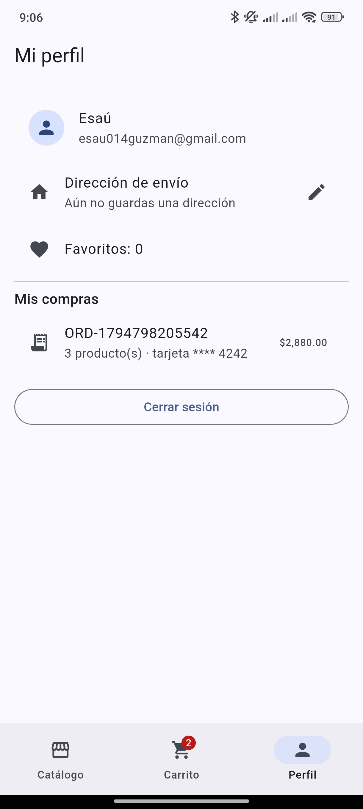
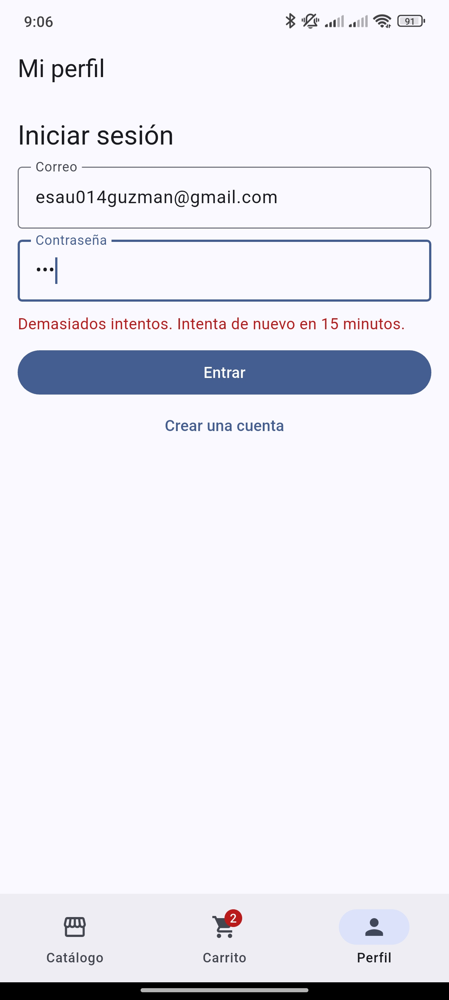
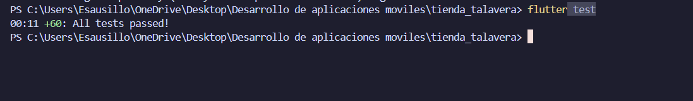

# Talavera Dolores 🏺

Tienda móvil de artesanías de Dolores Hidalgo, hecha en Flutter con TDD. Incluye catálogo, carrito, pagos, perfil de usuario y "Ver en tu espacio" con realidad aumentada.

Proyecto de la materia Desarrollo Móvil Integral, UTNG. Prof. Anastacio Rodríguez García.

> **Importante:** la pasarela de pagos y el servidor de cuentas son **simulados**. La app nunca procesa dinero real.

## Capturas

### Compra

| Catálogo | Detalle | Carrito con cupón |
|:--:|:--:|:--:|
|  |  |  |

| Checkout | Pago aprobado | Pago rechazado |
|:--:|:--:|:--:|
|  |  |  |

### Cuenta

| Mis compras | Perfil | Cuenta bloqueada |
|:--:|:--:|:--:|
|  |  |  |


### Pruebas



## Qué hace

- **Catálogo y detalle** de productos por categoría (talavera, dulces, textiles, decoración).
- **Carrito** con dinero en centavos enteros, IVA incluido, cupón `DOLORES10` (10 %), envío gratis desde $800 y límite de 10 piezas por producto.
- **Checkout** con validación de dirección y tarjeta (algoritmo de Luhn), pagos con clave de idempotencia (nunca cobra dos veces) y revalidación de precios.
- **Cuentas**: registro e inicio de sesión con sal + hash, mensajes de error genéricos y bloqueo tras 5 intentos fallidos.
- **Persistencia** del carrito (`shared_preferences`) y de la sesión (`flutter_secure_storage`).
- **Ver en tu espacio**: visor 3D y AR con `model_viewer_plus` (Scene Viewer en Android, AR Quick Look en iPhone).

## Arquitectura

Las dependencias apuntan siempre hacia el dominio.

```
lib/
├── dominio/        Reglas del negocio en Dart puro (sin Flutter)
├── datos/          Implementaciones: memoria, prefs, secure storage, simuladas
├── presentacion/
│   ├── vm/         ViewModels (ChangeNotifier)
│   └── pantallas/  Pantallas
├── dependencias.dart   Raíz de composición
└── main.dart
test/               dominio_test, servicios_test, viewmodels_test
```

## Cómo ejecutarla

Requisitos: Flutter 3 (Dart `>=3.0.0 <4.0.0`) y un teléfono Android con depuración USB.

```bash
flutter pub get
flutter devices
flutter run -d <id-del-dispositivo>
```

Para correr las pruebas:

```bash
flutter test
```

### Realidad aumentada

- Prueba en un **teléfono físico**: el simulador no soporta AR.
- Android necesita ARCore y "Servicios de Google Play para RA".
- Los modelos de ejemplo (astronauta y caballo de modelviewer.dev) son solo de práctica. Para publicar usa modelos propios `.glb` (Android) y `.usdz` (iPhone).

## Datos de prueba

| Caso | Tarjeta |
|---|---|
| Pago aprobado | `4242 4242 4242 4242` |
| Pago rechazado | `4000 0000 0000 0002` |

Cualquier vigencia futura y CVV de 3 dígitos (4 en Amex).

## Lista de verificación

- [ ] `flutter test` pasa en verde
- [ ] Compra con `4242…` y la orden aparece en "Mis compras"
- [ ] La tarjeta `4000 0000 0000 0002` muestra el rechazo y no descuenta inventario
- [ ] Cerrar y reabrir la app conserva carrito y sesión
- [ ] Cinco intentos de login fallidos bloquean la cuenta
- [ ] "Ver en tu espacio" abre el visor 3D (y la AR en un teléfono compatible)

## Cómo tomar las capturas

Con la app corriendo en el teléfono, abre **otra terminal** en la carpeta del proyecto y ejecuta:

```powershell
flutter screenshot -d <id-del-dispositivo> -o screenshots/01_catalogo.png
```

Cambia el nombre del archivo por cada captura. Los archivos que hoy están en `screenshots/` son marcadores de posición con los mismos nombres: reemplázalos y el README se actualiza solo.

## Tecnologías

Flutter · `model_viewer_plus` · `shared_preferences` · `flutter_secure_storage` · `crypto`